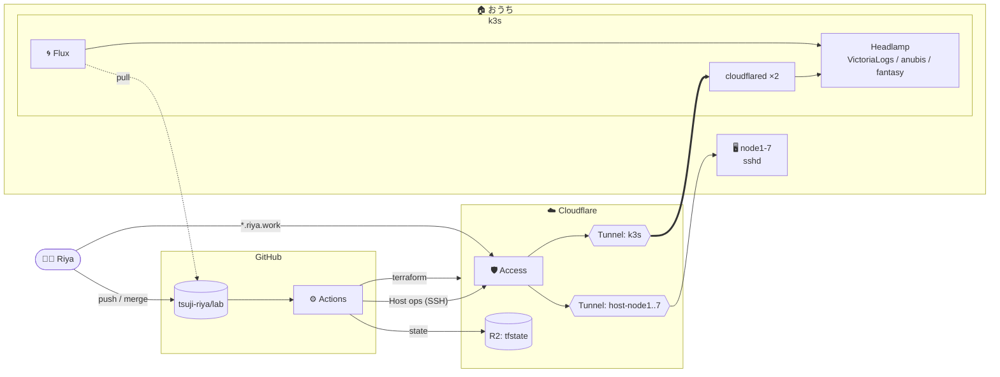
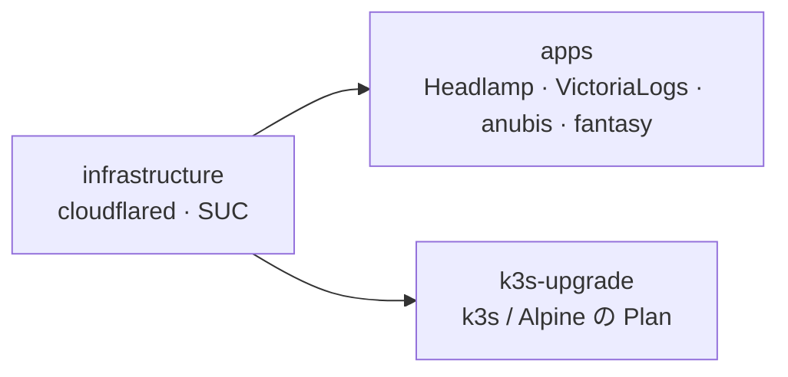
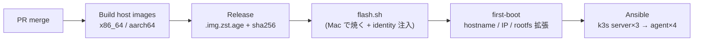

# 🐱 lab

おうちの k3s クラスタを **ベアメタルから全部コード** で管理するリポジトリ。

| 層 | 道具 | 反映のしかた |
| --- | --- | --- |
| 🧱 **ホスト** (`hosts/`) | Alpine image + Ansible | image を焼く / `Host ops` を手動実行 |
| ☁️ **外周** (`terraform/`) | Terraform → Cloudflare / k8s | `main` に merge で CI が apply |
| 🌀 **クラスタ** (`fluxcd/` `infrastructure/` `apps/`) | Flux CD | `main` に merge で Flux が同期 |

> [!NOTE]
> `hosts/**` はクラスタには一切デプロイされません。ホスト層の詳細は [hosts/README.md](hosts/README.md) へ。

---

## 🖥️ ノード

| ノード | IP | ロール | ハード | Arch |
| --- | --- | --- | --- | --- |
| node1 | `192.168.1.10` | server | ミニ PC | x86_64 |
| node2 | `192.168.1.11` | server | ミニ PC | x86_64 |
| node3 | `192.168.1.12` | server | ミニ PC | x86_64 |
| node4 | `192.168.1.13` | agent | 🍓 Raspberry Pi + USB SSD | aarch64 |
| node5 | `192.168.1.14` | agent | 🍓 Raspberry Pi + USB SSD | aarch64 |
| node6 | `192.168.1.15` | agent | 🍓 Raspberry Pi + USB SSD | aarch64 |
| node7 | `192.168.1.16` | agent | 🍓 Raspberry Pi + USB SSD | aarch64 |

OS は全台 **Alpine 3.24**、k3s は **v1.37.2+k3s1**（`hosts/ansible/group_vars/all.yml` でピン）。

---

## 🗺️ 全体像

---

## 🌀 クラスタ (Flux)

| 種類 | コンポーネント | バージョン | メモ |
| --- | --- | --- | --- |
| 🚇 公開経路 | cloudflared | `2026.11.2` | ×2、ポート開放なし |
| 🔁 自動更新 | system-upgrade-controller | `v0.21.1` | k3s は stable 追従、Alpine は週次 (日曜 3:00) |
| 🔦 UI | Headlamp | chart `0.46.0` | 閲覧専用 |
| 📜 ログ | VictoriaLogs + Vector | chart `0.13.12` | 全ノードのログを収集 |
| 🎮 サイト | anubis | Anubis `v1.28.2` | Anubis ちゃんが無限に出る ([repo](https://github.com/tsuji-riya/anubis.riya.work)) |
| 🎮 サイト | fantasy | `1.0.18` | ブラウザで Fantasy Zone、ROM は手元から ([repo](https://github.com/tsuji-riya/fantasy.riya.work)) |

---

## 🌐 公開ホスト

| ホスト | 行き先 | 制限 |
| --- | --- | --- |
| `headlamp.riya.work` | Headlamp | 🔒 Access `owner-only` |
| `logs.riya.work` | VictoriaLogs | 🔒 Access `owner-only` |
| `anubis.riya.work` | anubis | 🌍 公開 |
| `fantasy.riya.work` | fantasy | 🌍 公開 |
| `k3s-api.riya.work` | k3s API `:6443` | 🤖 CI (`host-ops-ci`) / 🔒 `owner-only` |
| `ssh-node{1..7}.riya.work` | 各ノードの sshd | 🤖 CI (`host-ops-ci`) / 🔒 `owner-only` |

---

## 🧱 ホスト層 (`hosts/`)

| ディレクトリ | 中身 |
| --- | --- |
| `image/` | image ビルド (world / overlay / nftables 既定拒否 / 鍵のみ sshd) |
| `flash/` | 書き込みとノード固有値 (`nodes.conf`) の注入 |
| `ansible/` | `site.yml` (収束) · `bootstrap-cluster.yml` (初回) · `ops.yml` (day-2) |
| `docs/` | runbook |

> [!IMPORTANT]
> image は age 暗号化して Release に置きます。秘密鍵は Mac の `~/.config/lab-hosts-age.txt` だけ。失うと過去の image は復号できません。

---

## ⚙️ GitHub Actions

| Workflow | トリガー | やること |
| --- | --- | --- |
| `deploy` | PR / `main` push | `terraform plan` → `apply` → Flux 適用 |
| `image-scan` | PR / push / 毎週月曜 | Trivy でコンテナ image をスキャン |
| `Build host images` | `hosts/**` の PR / `hosts-v*` タグ / 手動 | Alpine image をビルドして Release |
| `Host ops` | 手動のみ (要承認) | Tunnel 経由 SSH でパッケージ更新 / 再起動 |
| `Host update check` | 毎週月曜 9:00 | k3s / Alpine の新版があればピン更新 PR |

Dependabot はコンテナ image と Actions を担当（Helm chart と Flux 本体は手動）。

---

## 🔐 シークレット

- Git には平文を置かない。CI へは GitHub Secrets / Environment 経由
- DB パスワード・Tunnel トークンは Terraform が生成して k8s Secret に
- k3s token は bootstrap 時に node1 で生成し、メモリ上でのみ配布
- SSH は公開鍵のみ。鍵は焼き込み時に注入し image にも Git にも入れない

---

## 📜 ログを見る

[logs.riya.work/select/vmui/](https://logs.riya.work/select/vmui/) でクエリを実行。

よく使うクエリ

| 見たいもの | クエリ |
| --- | --- |
| dmesg | `source:=dmesg` |
| k3s (server) | `source:="/var/log/k3s.log"` |
| k3s-agent | `source:="/var/log/k3s-agent.log"` |
| ノードで絞る | `host:=node4 source:=dmesg` |
| namespace の Pod | `kubernetes.pod_namespace:=headlamp` |
| Pod 名で絞る | `kubernetes.pod_name:anubis*` |
| エラーっぽい行 | `kubernetes.pod_namespace:=anubis error` |

- 空白区切りで AND、`or` / `not` も可
- 保存先は emptyDir（最大 7 日 / 5GiB）。Pod 再起動で消える
- Vector 再起動で dmesg が重複して入る

---

## ➕ アプリを足す

- [ ] `terraform/kubernetes.tf` に Namespace と Secret
- [ ] `apps/<name>/` を作り `apps/kustomization.yaml` に登録
- [ ] 公開するなら `terraform/cloudflare/tunnel.tf` と `dns_record.tf` にホスト名
- [ ] PR → merge で完了 🐱

---

Made with 💖 and 🐈 🐈‍⬛
